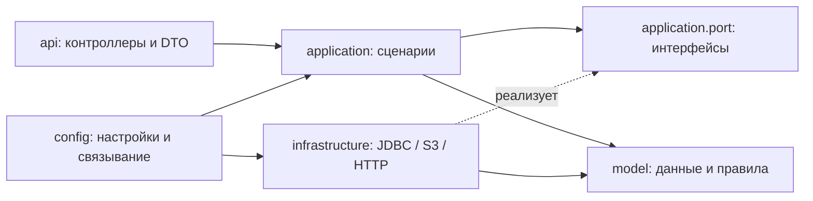

# Структура backend-сервисов

Используем **package by feature**: верхний уровень пакетов отражает функции сервиса, внутри функции отделены HTTP, сценарии, модели и внешние системы. Это практический вариант ports and adapters для текущего размера проекта. Единого дерева каталогов для всех big tech-компаний нет; здесь границы проверяются сборкой.

## Устройство Maven-проекта

```text
plot-twist/
├── pom.xml                       # версии, плагины и модули
├── auth-service/                 # идентификация и выдача токенов
├── api-service/                  # публичный API и передача запросов
├── domain-service/               # профили, истории и S3-фотографии
├── docker/                      # образы и конфигурация инфраструктуры
├── scripts/                     # сквозные и эксплуатационные проверки
├── monitoring/
└── docs/
```

Каждый сервис — отдельный deployable Maven-модуль с `src/main/java`, `src/main/resources` и `src/test/java`. Родительский POM управляет общими версиями и форматированием. Сервисы взаимодействуют через HTTP/JWT, без Java-зависимостей друг на друга. В корне Java-пакета сервиса остаётся только `*Application`, чтобы Spring сканировал дочерние пакеты.

## Слои внутри функции

```text
<service>/src/main/java/io/plottwist/<service>/
├── <feature>/
│   ├── api/                     # контроллеры, HTTP-валидация и преобразования
│   │   ├── request/             # входные DTO
│   │   └── response/            # выходные DTO, если они отличаются от модели
│   ├── application/             # сценарии, транзакции, ошибки сценариев
│   │   └── port/                # интерфейсы БД, хранилища и внешних сервисов
│   ├── model/                   # модели и правила без Spring/JDBC/HTTP
│   └── infrastructure/          # реализации портов и фоновые обработчики
│       ├── persistence/
│       ├── http/
│       └── s3/
├── config/                      # сборка Spring-компонентов и настройки
├── shared/web/                  # общие HTTP-ошибки и ограничения запросов
└── diagnostics/                 # технические и совместимые старые endpoints
```

Дерево описывает назначение пакетов: в конкретном модуле создаются только пакеты с реальным кодом. Например, gateway не нуждается в доменной модели или JDBC-репозитории, а outbox не имеет собственного публичного контроллера.



## Что изменено

| Сервис | Функции | Внешние адаптеры |
|---|---|---|
| `auth-service` | `account`, `notification`, `oauth`, технический `security` | `JdbcAccountRepository`, `JdbcEmailOutbox`, SMTP worker, JDBC OAuth, ключи подписи |
| `domain-service` | `profile`, `media`, `story` | `JdbcStoryRepository`, `JdbcProfileRepository`, `JdbcMediaRepository`, `S3ObjectStorage`, `ImageSanitizer`, media cleanup |
| `api-service` | `profile`, `story`, `diagnostics` | `DomainHttpClient` и диагностический HTTP-клиент |

`AccountService` больше не содержит SQL: он работает через `AccountRepository` и `EmailOutbox`. Вставка аккаунта, кода и outbox-сообщения остаётся одной транзакцией. SMTP выполняется фоновым адаптером.

`ProfileService` зависит от `ProfileRepository`, `MediaRepository`, `ObjectStorage` и `PhotoProcessor`. SQL и AWS SDK вынесены из сценариев. Резервирование объекта по-прежнему коммитится до S3-записи; активация фото, проверка версии профиля и отложенное удаление прежнего объекта выполняются согласованно в БД. Ошибки сценариев преобразуются в HTTP только в `shared/web/ProblemAdvice`.

`UpdateProfileRequest` содержит HTTP-валидацию, `ProfileDetails` и `Profile` — чистые модели. `ProfileResponse` формирует публичное представление, включая URL фото. Модель не знает маршрутов API. В API-сервисе `ProfileGateway` зависит от интерфейса `DomainBackend`, реализация `DomainHttpClient` содержит HTTP-вызовы и сохраняет статус, `ETag` и разрешённые заголовки ответа.

Gateway — транспортный сервис, поэтому его порт использует `HttpMethod`, `MediaType` и `ResponseEntity`. Это намеренный HTTP-контракт, не бизнес-модель. Application-слой auth/profile допускает Spring-компоненты и управление транзакциями; HTTP, JDBC и SDK находятся вне него. Технические Spring Security/OAuth настройки и обработчики не маскируются под бизнес-сценарии.

Бывший `AuthConfig` разделён на настройки security chains, учётных данных, OAuth persistence, регистрации клиентов и issuer/JWK. Проверка browser redirect и создание браузерного клиента выделены в OAuth-адаптеры. Тесты перенесены в пакеты соответствующих компонентов. Flyway-миграции остаются в `resources/db/migration`: опубликованные SQL-файлы не изменены.

## Правила, проверяемые сборкой

В каждом сервисе есть `architecture/ArchitectureTest` с ArchUnit:

1. В корневом Java-пакете находятся только bootstrap-классы приложения.
2. `model` зависит только от JDK и других моделей.
3. `application` не зависит от контроллеров, инфраструктурных реализаций, JDBC, AWS SDK, Servlet и Spring Web.
4. Контроллеры функций не вызывают JDBC, SDK и HTTP-клиенты напрямую.
5. Инфраструктура не использует входные/выходные HTTP DTO.
6. Между верхнеуровневыми функциональными пакетами нет циклов.

ArchUnit запускается вместе с обычными тестами. Spotless с закреплённой версией Google Java Format проверяет Java на фазе `validate`, в том числе при Docker-сборке. `.mvn/jvm.config` даёт formatter доступ к API компилятора JDK; Docker build подключает эту конфигурацию. Эти параметры относятся к Maven, не к runtime сервисов. POM-файлы приведены к читаемому многострочному виду.

```sh
./mvnw spotless:apply             # привести Java к единому формату
./mvnw verify                     # формат, компиляция и тесты всех сервисов
./mvnw -pl domain-service -am verify
```

В PowerShell используйте `./mvnw.cmd`. Локальной Maven-сборке нужен JDK 25. Docker-вариант использует JDK из образа:

```sh
docker compose build
docker compose up -d --no-build --wait --wait-timeout 180
python3 scripts/smoke-test.py
python3 scripts/test-auth.py
python3 scripts/test-profile.py
```

Добавляя функцию, сначала выберите её владельца и API. HTTP DTO относятся к `api`, правила — к `model`, последовательность действий и транзакции — к `application`, интеграции — к `infrastructure`. Новый порт нужен для настоящей внешней границы; создавать интерфейс для каждого класса не требуется. В `shared` помещается только технический код, используемый несколькими функциями. Новое правило зависимостей закрепляется архитектурным тестом.

Эта реорганизация касается исходного кода и сопровождаемости. Требования к HA, секретам, резервным копиям и эксплуатации описаны отдельно в [production runbook](production.md).

Функция `story` владеет лентой, оценками и комментариями: HTTP DTO в `api/request`, сценарии/транзакции в `application`, чистые записи в `model`, PostgreSQL SQL в `infrastructure/persistence`. API-сервис использует общий транспортный порт в `shared/application/port` и HTTP-адаптер в `shared/infrastructure/http` для профиля и историй. [Контракт и конкурентность](stories.md).
