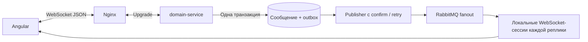

# Личные чаты

В профиле другого пользователя нажмите **Написать сообщение**. В меню **Сообщения** (`/chats`) видны ваши диалоги, последнее сообщение и непрочитанные. `/chats/{id}` открывает переписку; F5 восстанавливает этот адрес после входа. Подписка друг на друга не требуется. Новый получатель должен иметь публичный профиль; с пустым собственным профилем отправлять можно.

Один диалог соответствует одной паре аккаунтов. Открытие не отправляет сообщение: у получателя пустой диалог появится после первого сообщения либо после его собственного открытия этой пары. Поддерживается обычный текст до 4000 UTF-16 единиц, Enter отправляет, Shift+Enter добавляет строку. Изображения, редактирование, удаление, блокировки и групповые чаты в эту версию не входят.

Сообщения отображаются как текст, HTML не выполняется. Имена/фото ведут в публичный профиль; имя, фамилия, дата рождения и email не включаются в ответы чатов. Удаление данных профиля не удаляет аккаунт и переписку: существующий диалог остаётся доступен по ID, без никнейма показывается «Читатель».

## Доступ и хранение

`chat` — отдельный функциональный пакет в domain-service: API → application → repository port → JDBC/PostgreSQL. api-service проверяет scope/тип аккаунта и передаёт пользовательский JWT; domain-service повторно проверяет account_id == sub и участие в паре при каждом чтении/записи. Угадывание UUID чужого диалога возвращает тот же 404, что отсутствующий диалог. Ответы имеют `Cache-Control: no-store`.

Flyway **V11** добавляет `direct_chats` и `direct_messages` в БД domain-service. Сообщения хранятся на сервере, **сквозного шифрования нет**. В production трафик должен идти через уже предусмотренный TLS; права БД, диски, резервные копии и сроки хранения требуют той же защиты, что другие личные данные. Тексты не отправляются в RabbitMQ публичной модерации, embeddings, Qdrant или ленту историй. Не включайте логирование HTTP/JDBC тел и содержимого сообщений.

Canonical UUID-пара и UNIQUE обеспечивают один диалог; транзакционная advisory-блокировка защищает одновременное открытие с обеих сторон. Каждая отправка блокирует одну строку диалога, назначает следующий последовательный номер и атомарно обновляет последнюю активность. Разные диалоги не блокируют друг друга. `clientMessageId` генерируется клиентом; UNIQUE(chat,sender,key) и сверка нормализованного текста предотвращают дубликаты при повторах, иной текст с прежним ключом даёт 409. История загружается страницами с индексом по `(chat_id,sequence)`, входящие непрочитанные — с индексом `(chat_id,sender_id,sequence)`.

## Обновление и прочтение

Angular открывает **нативный WebSocket** `/ws/chats` (JSON, без STOMP/SockJS). По нему отправляются сообщения/прочтения, приходят ACK и уведомления об изменениях. Опрос раз в 3 секунды удалён. История и список диалогов остаются в REST: клиент запрашивает их при входе, по серверному событию, после reconnect или возвращения во вкладку. Событие содержит только chatId; `messages?after=N` догружает новые строки, включая пропущенные. Пачки событий объединяются, повторные уведомления безопасны. Периодического HTTP-запроса в исправном простаивающем чате нет; ошибки REST восстанавливаются отдельными повторами с паузами.

При чтении старой истории новые сообщения не перетягивают прокрутку; есть кнопка перехода вниз. Read-команда отправляется, когда видима нижняя часть переписки, и может только увеличивать marker. GET ничего не помечает. Собственные сообщения не увеличивают непрочитанные; «Прочитано» означает marker собеседника, а не гарантию внимания человека.

При ошибке отправки текст фиксируется и появляется **Повторить отправку**: повтор использует прежний UUID и текст. Черновики находятся только в памяти открытой страницы, не в localStorage; при F5/уходе с экрана несохранённый текст теряется. Если сервер успел сохранить сообщение до сетевого сбоя, оно придёт при обновлении истории. Повторять нужно кнопкой с прежним ключом.

## WebSocket, доставка и реплики



Spring WebSocket работает в domain-service. Nginx проксирует только `/ws/chats` напрямую в него, REST продолжает идти через api-service. Gateway подключён также к сети services. Один TCP-канал закреплён за выбранной репликой до закрытия; sticky sessions между reconnect не требуются. `ChatService` атомарно сохраняет сообщение/read marker и метаданные в `chat_event_outbox` (Flyway **V12**). Publisher каждые 100 мс забирает до 64 записей через lease / SKIP LOCKED, ждёт Rabbit publisher confirm и удаляет только подтверждённую запись. После сбоя — повтор; при падении реплики lease истечёт через 30 секунд.

Exchange `plot-twist.chat.events.v1` — отдельный fanout, **не очередь публичной модерации**. У каждой реплики своя exclusive auto-delete очередь, максимум 10 000 событий / 4 MiB, с reject-publish при заполнении. В брокере только eventId, chatId и UUID получателей; текст сообщения не передаётся. Клиент получает invalidation только своего аккаунта, без произвольной подписки на чужие chatId. После восстановления Rabbit consumer сервер закрывает старые WS: reconnect и REST восстанавливают пропущенное. События доставляются как минимум один раз при доступной очереди; ACK отправки подтверждает коммит в PostgreSQL, а не получение/прочтение другой стороной. Офлайн-пользователю история доступна при следующем входе, держать для него очередь в Rabbit не требуется.

Первый кадр — `{"type":"auth","token":"<access token>"}` в течение 10 секунд. Токен остаётся в памяти, не передаётся в URL, subprotocol, логи или хранилище браузера. Сервер использует тот же JwtDecoder с проверкой подписи, issuer, audience `plot-twist-domain`, срока и account_id == sub. Для соединения нужен api.read, для send/read — api.write. `scope` поддерживает и массив Authorization Server, и строку. HTTP-upgrade без авторизации не даёт доступа к данным. Origin проверяется по точному allowlist; query string и запросы без Origin отклоняются до upgrade.

Пример команд после `ready`:

```json
{"type":"send","requestId":"UUID запроса","chatId":"UUID диалога","clientMessageId":"UUID сообщения","body":"Привет!"}
{"type":"read","requestId":"UUID запроса","chatId":"UUID диалога","throughSequence":42}
{"type":"ping"}
```

Ответы: `ack` с тем же requestId и `message`/`summary`, `error` с requestId и HTTP-подобным status (400/403/404/409/503), `changed` с chatId, `pong`. Полные схемы — `x-websocket` в OpenAPI. requestId коррелирует одну попытку; **clientMessageId сохраняется при повторе отправки**, в том числе после потерянного ACK. Сокет не предоставляет editing/deletion/произвольные SQL/подписки.

Браузер отправляет ping примерно раз в 20 секунд, ждёт pong 10 секунд; сервер завершает простаивающее соединение через 75 секунд. После обрыва клиент переподключается с exponential backoff и jitter до 30 секунд, затем загружает изменения. Таймаут ACK — 15 секунд. При истечении JWT сервер закрывает сокет с **4401**, frontend направляет на логин. 1012/1013 означают восстановление сервиса/перегрузку и допускают reconnect. При недоступном broker соединение не выдаёт ложный ready. По умолчанию ограничены размер кадра 32 KiB, 30 команд/сек на соединение, 8 соединений на аккаунт и 5000 соединений на реплику; медленный клиент имеет ограниченный send buffer и отключается. Эти пределы не заменяют распределённые пользовательские лимиты при массовом публичном запуске.

Метрики: `chat.websocket.connections`, `chat.websocket.authenticated`, `chat.outbox.pending`, `chat.outbox.sent`, `chat.outbox.failures`. Следите за возрастом/ростом outbox, ошибками и reconnect, прежде чем повышать нагрузку. Пропускная способность не измерена нагрузочным тестом. Отдельный deployable chat-service можно выделить при самостоятельной команде/SLO; сейчас функциональная граница сохраняется в пакете chat.

## API

Полные DTO и ошибки — в [OpenAPI](openapi.json), версия 1.11.0.

| Метод | Путь | Назначение |
|---|---|---|
| POST | `/api/v1/chats` | `{recipientId}` → общий диалог, 200 |
| GET | `/api/v1/chats?limit=20&cursor=…` | Диалоги, максимум 30; cursor привязан к viewer |
| GET | `/api/v1/chats/{id}` | Собеседник, lastSequence, readThrough, peerReadThrough, unreadCount |
| GET | `/api/v1/chats/{id}/messages?limit=50` | Последние сообщения по возрастанию sequence, максимум 100 |
| GET | `/api/v1/chats/{id}/messages?before=N` | История строго до N, nextBefore для следующей страницы |
| GET | `/api/v1/chats/{id}/messages?after=N` | Новые строго после N, hasMoreNewer при наличии следующей страницы |
| POST | `/api/v1/chats/{id}/messages` | `{clientMessageId,body}` → 201; прежний ключ/текст → 200; другой текст → 409 |
| PUT | `/api/v1/chats/{id}/read` | `{throughSequence}` → актуальный ChatSummary |

GET требует `api.read`, POST/PUT — `api.write`, все требуют подтверждённый аккаунт. `before` и `after` взаимоисключающие. Read marker не может указывать в будущее. Пагинация диалогов живая: обновляйте начало для новой активности. Не передавайте senderId/accountId в теле — сервер отклоняет неизвестные поля.

## Обновление

В backend-ветке `feature/spring-boot-docker-compose`:

```sh
git pull --ff-only
docker compose up -d --wait rabbitmq
docker compose up -d --build --no-deps --wait domain-service api-service gateway
```

Зависимости существующего стека должны уже работать. V11/V12 применяются автоматически, существующие данные сохраняются; не удаляйте volumes. Gateway пересобирается для обновления `/openapi.json`. Используется существующий RabbitMQ, новых типов инфраструктуры/секретов нет. При первом запуске broker дождитесь его healthcheck. Для production задайте `CHAT_ALLOWED_ORIGINS=https://app.example.com,https://api.example.com` (точные browser origins, без путей, wildcard и завершающего `/`). Пример env обновлён; произвольные origins не разрешаются. Для нестандартного dev-порта добавьте его origin в этот список. Обновлены Upgrade/Connection и таймауты backend Nginx и frontend Nginx; CSP разрешает WS/WSS только текущего host.

Затем в отдельном `plot-twist-web`, ветка main: `git pull --ff-only`, `npm ci`, перезапуск `npm start`; при Docker-сборке frontend пересоберите его образ.

## 404 на списке диалогов

Если `GET /api/v1/chats?limit=20` возвращает `No static resource api/v1/chats.`, запрос дошёл до Spring, но в одном из запущенных сервисов нет этого маршрута. Проверьте, что получена ветка `feature/spring-boot-docker-compose`, и выполните полную команду обновления выше, включая **api-service**. Он передаёт REST-запросы списка/истории в domain-service даже после перехода отправки на WebSocket. Compose обновит обе настроенные реплики API; удалять данные или volumes не требуется.

Если после успешной пересборки 404 остаётся, проверьте, что frontend обращается к нужному gateway (`BACKEND_TARGET` для npm start / `BACKEND_ORIGIN` для Docker), и соберите `git log -1 --oneline`, `docker compose ps api-service domain-service gateway`, `docker compose logs --no-color --tail=80 api-service domain-service`. Не публикуйте токены или заголовки Authorization.

## Изолированные проверки

Без модели, S3, OAuth и frontend, с отдельными PostgreSQL и RabbitMQ:

```sh
docker compose -p plot-twist-chat-test -f compose.chat-test.yaml run --rm --build chat-tests
docker compose -p plot-twist-chat-test -f compose.chat-test.yaml down -v
```

Удаление volumes здесь относится **только к отдельному тестовому проекту**. `CHAT_INTEGRATION=true` включает проверки БД; `CHAT_SOCKET_INTEGRATION=true` — настоящий embedded Tomcat, Java WebSocket-клиенты и RabbitMQ. JWT endpoint fixtures подменяют только decoder, а права, транзакции, HTTP/WS, брокер и fanout выполняются реально; подпись/issuer/audience дополнительно проверяются существующими тестами JwtDecoder. Есть сценарии чужого диалога, массивов scope, Origin/query rejection, команд до auth, идемпотентности, read markers, истечения токена, двух независимых очередей и перезапуска consumer с восстановлением истории. Тест обычного REST-чата проверяет также атомарный rollback outbox и отсутствие лишних событий на повтор/старый read marker. CI запускает этот Compose отдельно.

В frontend: `PLAYWRIGHT_PORT=4300 npm test`, PowerShell: сначала `$env:PLAYWRIGHT_PORT="4300"`. Browser-тесты используют подставные HTTP/OAuth/WebSocket-ответы: переход из профиля, история/HTML, потерянный ACK после сохранения, повтор без дублирования, гонка входящего/исходящего, отсутствие периодического HTTP-polling, reconnect/catch-up, истёкший токен, F5, мобильная версия и 404. Это проверка UI-контракта; сквозной запуск двух реальных аккаунтов в полном развёрнутом стеке остаётся отдельной deployment-проверкой.
