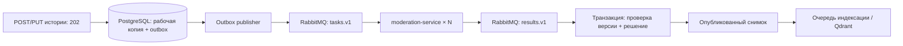

# Асинхронная модерация историй

`moderation-service` — отдельный stateless Spring Boot/Java 25 сервис. Собственной БД нет: он читает неизменяемые задания из RabbitMQ, проверяет текст и публикует решение. `domain-service` владеет историями, рабочими копиями, опубликованными версиями, outbox и журналом решений.



## Поведение API и интерфейса

POST `/api/v1/stories` и PUT `/api/v1/stories/{id}` возвращают **202 Accepted**, тело истории и ETag рабочей версии. Для PUT сохраняется обязательный `If-Match`. Автор видит `moderationStatus`: `PENDING_MODERATION`, `PUBLISHED`, `REJECTED`, `REVIEW_REQUIRED`, пояснение `moderationReason` и `publishedVersion`. Чужому читателю доступны только одобренный текст/версия и статус `PUBLISHED`; сведения о черновике и причине отказа не раскрываются.

Новую историю до одобрения видит только автор, включая прямой GET по ID; она доступна в «Моих историях». При правке старая одобренная версия остаётся опубликованной до одобрения новой. Отказ относится к новой рабочей копии, сохраняя старую публикацию. Если опубликованной версии нет, оценки и комментарии недоступны. Ленты, рекомендации и векторный worker читают только опубликованные снимки. Удаление истории отменяет её outbox; запоздалое решение ничего не восстанавливает.

Angular показывает статус/причину и раз в 5 секунд обновляет ожидающие карточки текущего автора в активной вкладке. Оценки отключены до первой публикации. Вкладку «Мои истории» можно обновить вручную.

Flyway V7 сохраняет видимость ранее опубликованных историй без ретроактивной проверки. Новая политика применяется к новым историям и последующим правкам. При обновлении нужны оба репозитория: HTTP-коды создания/редактирования изменились с 201/200 на 202.

## Надёжность и ограничения нагрузки

Триггер PostgreSQL создаёт задание в той же транзакции, что и рабочий текст. Откат не оставляет «потерянной» публикации. Publisher резервирует строки через `FOR UPDATE SKIP LOCKED` и lease token; сетевой вызов идёт после завершения короткой транзакции. После persistent publish проверяются publisher confirm и mandatory return. При неудаче запись остаётся для повторной попытки с backoff.

Worker подтверждает задание только после подтверждённой публикации результата. Domain подтверждает результат после коммита решения. Доставка **at-least-once**: повторы ожидаемы. Решение применяется только к совпавшим job ID, версии, SHA-256 текста и версии политики в состоянии ожидания. Повтор, удалённая история и старый результат игнорируются. Проверка использует реальную БД, не доверяя только содержимому сообщения.

Очереди durable/quorum, по 10 000 сообщений и 128 MiB для задач/результатов, с `reject-publish`. При переполнении publisher не отмечает задание отправленным. Ошибки обработчика повторяются до трёх раз; poison-сообщения уходят в отдельную quorum DLQ через at-least-once dead lettering. DLQ ограничена 10 000 сообщений и сроком 7 дней. Задания без решения повторно отправляются после 15 минут; после 25 попыток требуется оператор. Очередь PostgreSQL при этом сохраняется. Один автор может иметь до 20 ожидающих историй; новые запросы сверх лимита получают 429. Лимит сериализован между репликами через короткий advisory transaction lock на автора.

Каждый worker по умолчанию имеет 2 consumer и prefetch 4. Нет Rabbit ports на хосте; отдельная внутренняя сеть соединяет broker, domain и moderation. Сообщения содержат текст: доступ к брокеру/его резервным копиям должен быть только у доверенных операторов. Приложения не выводят тело сообщений в логи ошибок. Решения без текста хранятся 90 дней. Новая правка заменяет устаревшее задание, а завершённое удаляется из outbox.

Quorum-очередь на одном RabbitMQ узле не обеспечивает HA. Для HA нужен кластер минимум из трёх узлов, мониторинг диска и проверенная процедура восстановления. PostgreSQL/outbox остаются источником заданий при потере брокера. Compose-вариант рассчитан на одну машину. Лимиты контейнеров: RabbitMQ 512 MiB, moderation-service 384 MiB; реальную пропускную способность нужно измерять на своём железе.

## Политика

Начальный словарь: `moderation-service/src/main/resources/policy/basic-v1.tsv`. Явные выражения дают BLOCK, неоднозначное «сука» — REVIEW (например, история о собаках). Полный контекст цитат и все формы русского мата эта стартовая политика не распознаёт. Это не ML-классификатор и не основание для автоматического бана аккаунта.

Проверка использует NFKC, регистр, удаление невидимых format-символов, похожие латинские/кириллические буквы, повторение букв и некоторые способы маскировки. Поиск идёт по целым токенам/фразам алгоритмом Aho–Corasick, без произвольных регулярных выражений из словаря. Исходный текст не изменяется. Проверки отдельно покрывают обходы и слова «страхуй», «рубля», «педикюр», чтобы уменьшить ложные совпадения.

Версия wire-контракта проверяется при чтении JSON; Java-десериализация и выбор класса по заголовкам не используются. Версия политики `basic-v2` фиксируется в заданиях, SHA-256 словаря сохраняется в решении. Изменение семантики правил требует согласованного версионирования и развёртывания producer/worker; горячей замены политики нет.

## Запуск и операторские действия

Обычное обновление backend: `docker compose up -d --build --wait --wait-timeout 600`. Для обновления только затронутых сервисов при уже работающих зависимостях:

```sh
docker compose up -d --build --wait rabbitmq moderation-service domain-service api-service
```

В production нужен `secrets/rabbitmq-password`: он подключается через Docker secrets, dev password удаляется override. Новый `provision-secrets.py` создаёт этот файл; существующий каталог секретов не перезаписывается. Файл должен читаться UID 999 Java-сервисов; broker entrypoint читает его до перехода на пользователя RabbitMQ. Используйте отдельный production Compose project. Изменение пароля в secret не меняет автоматически пароль пользователя уже существующего Rabbit volume — ротация выполняется оператором согласованно с клиентами.

```sh
docker compose logs --tail=80 moderation-service domain-service
docker compose exec rabbitmq rabbitmqctl -q list_queues -p /plot-twist name messages consumers
python3 scripts/retry-moderation.py
python3 scripts/moderate-story.py STORY_UUID --revision 2 --approve --operator admin --reason "Проверено вручную"
```

`retry-moderation.py` повторяет только dead-задания; `--all-pending` также повторяет отправленные задания после восстановления брокера. Ручное решение принимает только ожидающие ручной проверки/отклонённые рабочие версии и требует текущую revision; решение и пояснение оператора атомарно записываются в аудит. Скрипт требует доверенного доступа к БД, публичного admin API нет. Для просмотра спорного текста оператор использует свою защищённую консоль БД. Сообщения из DLQ не следует автоматически одобрять.

Grafana дополнена очередью pending/dead, возрастом задания, частотой решений и p95 обработки. После обновления конфигурации мониторинга перезапустите Prometheus для подключения нового scrape target: `docker compose restart prometheus`. Возраст задания и DLQ нужно контролировать наряду с HTTP p95.

## Изолированные проверки без полного проекта

Нужны Docker/Compose; auth, gateway, Angular, S3, Qdrant и embedding-модель не запускаются. Все ресурсы имеют отдельное имя проекта, БД и broker хранят тестовые данные в tmpfs, порты на хост не публикуются:

```sh
docker compose -p plot-twist-moderation-test -f compose.moderation-test.yaml run --rm --build domain-tests
```

После проверки удалить только ресурсы этого тестового проекта:

```sh
docker compose -p plot-twist-moderation-test -f compose.moderation-test.yaml down -v
```

Тесты проверяют настоящий RabbitMQ и worker: публикацию, блокировку, ручную проверку, приватность, дубликаты, запоздалое решение, редактирование/удаление, DLQ, unroutable publish и ограничение ожидающих постов. В обычной Maven-сборке интеграционные тесты пропущены; они включаются `MODERATION_INTEGRATION=true` в изолированном Compose и отдельном CI job. Отдельный DB-тест также проверяет миграцию V6 → V7 и откат текста вместе с заданием.

## Истории с вложениями

По умолчанию `MODERATION_MEDIA_REVIEW_REQUIRED=false`: после технической проверки файлов история проходит обычную текстовую политику и может публиковаться автоматически. Изображения, кадры и звук автоматически не анализируются. При `true` любая история с медиа требует ручной проверки, если текст ранее не заблокирован. [Форматы, приватный предпросмотр и обновление V8/basic-v2](story-media.md).
