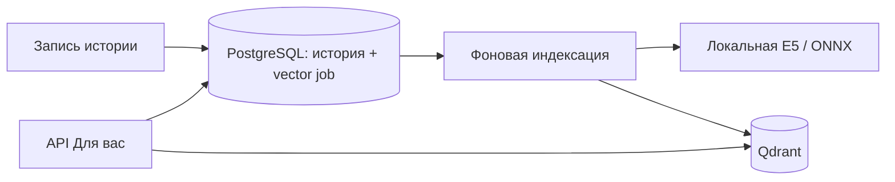

# Смысловые рекомендации

Вкладка Angular **Для вас** (`/feed?view=recommended`) использует отдельный Qdrant и локальную ONNX-модель `Xenova/multilingual-e5-small` (384 измерения). Тексты не отправляются в платный или внешний inference API. Hugging Face нужен только для первичного скачивания весов; runtime inference не имеет выхода в интернет. PostgreSQL остаётся источником истины для историй, оценок и прав доступа.

## Запуск

```sh
docker compose up -d --build --wait --wait-timeout 600
```

Первый запуск скачивает несколько сотен МБ модели. `model-download` разрешает выбранный revision в полный commit SHA, скачивает ONNX/tokenizer из этого commit, проверяет размер и upstream SHA-256 весов (Git blob SHA-1 для обычного файла tokenizer), выполняет пробный расчёт через настоящий Encoder и атомарно создаёт `embedding-model/manifest.json`. Повторный запуск проверяет кеш и warmup, не обновляя модель автоматически. Старый кеш проходит одноразовую проверку по метаданным исходного commit (`blobs=true`); повреждённые файлы перескачиваются автоматически. Самостоятельно вычисленный после скачивания хеш не заменяет сравнение с upstream: обрезанный ONNX может совпадать со своим старым manifest. Источники: https://huggingface.co/Xenova/multilingual-e5-small и https://huggingface.co/intfloat/multilingual-e5-small .

Загрузчик выводит выбранный commit, имя/размер файла и прогресс каждые 10 секунд передачи данных. Таймаут ожидания сетевых данных — 30 секунд, общий бюджет установки — 30 минут; временные ошибки повторяются до трёх раз, HTTP 400/401/403/404 завершают установку сразу. Неполный файл не активируется. У одноразового `model-download` отключена унаследованная проверка HTTP-сервера: успешное состояние — `Exited (0)`, а `embeddings` запускается только после этого. При медленной загрузке команда `--wait-timeout 600` может закончить ожидание раньше процесса; прогресс виден через `docker compose logs -f model-download`.

Если `embeddings` остался `Created`, а загрузчик долго работает без вывода на старой версии, обновите код и пересоздайте загрузчик с видимым выводом (команды подходят для PowerShell):

```sh
git pull
docker compose stop embeddings
docker compose up --build --no-deps --force-recreate --exit-code-from model-download model-download
```

После успешного завершения с кодом 0 запустите inference:

```sh
docker compose up -d --no-deps --force-recreate --wait --wait-timeout 180 embeddings
```

`embeddings` читает модель read-only, проверяет контрольные суммы и выполняет настоящую пробную inference до готовности. Используется CPU, ONNX Runtime, mean pooling, нормализация L2 и обработка длинных историй перекрывающимися блоками до 512 токенов. Лимиты документа, числа блоков, входных байтов и двух параллельных вычислений ограничивают память. API не загружает модель по запросу пользователя. Зависимости Python закреплены версиями и wheel SHA-256, образы — digest.

Для загрузки нужны `huggingface.co`, `*.huggingface.co`, `*.hf.co`, `*.xethub.hf.co`. Если сеть среды запрещает эти домены, модель не считается установленной и семантическая проверка не может пройти. Не заменяйте её случайными/хешированными векторами. После скачивания доступ наружу inference-контейнеру не нужен. `MODEL_REVISION`/Compose `EMBEDDING_MODEL_REVISION` принимает полный commit SHA; локальный `main` разрешается только при первом скачивании.

## Поток изменений



Flyway V4 добавляет очередь, индексные метаданные, историю чтения и снимки выдачи. V5 сохраняет время последней смены оценки; V6 индексирует внешние ключи/retention и выделяет tombstone-задания для удаления без сканирования очереди живых историй. PostgreSQL-триггеры вставляют задание в той же транзакции, что INSERT/UPDATE/DELETE истории. Откат записи откатывает и задание. Оценки не требуют пересчёта текста: они обновляют персональную revision; повторная установка того же голоса не меняет её.

Очередь содержит одну запись на историю и объединяет промежуточные правки. Воркеры резервируют строки через `FOR UPDATE SKIP LOCKED`, lease token и срок 2 минуты. Сеть/inference выполняются вне транзакции. Generation/lease сравниваются перед записью и подтверждением; retry использует backoff, после 10 ошибок задание остаётся в dead-состоянии для оператора. Новая правка автоматически создаёт новую generation и снимает dead. Обработчики используют ограниченный фоновой запуск на virtual threads, не блокируя общий scheduler и очистку фото.

Point ID зависит от story ID, версии текста и модели. Запоздалый сетевой запрос старой версии не перезаписывает новый вектор. Payload содержит только ID истории/автора и версию, без текста, email и личного профиля. Кандидаты повторно проверяются в PostgreSQL по актуальной версии; удалённые/устаревшие точки не становятся карточками. Отдельный обработчик удаляет точки истории во всех управляемых коллекциях даже при недоступной inference. Фоновый сборщик удаляет оставшиеся устаревшие точки; repair восстанавливает пропущенные индексные задания.

Fingerprint модели включает revision, хеши файлов и алгоритм pooling/chunking. Каждому fingerprint соответствует своя коллекция `stories_e5_<fingerprint-prefix>`. Векторы разных моделей не смешиваются. При смене модели создаётся новая коллекция и идёт постепенная переиндексация. Старые коллекции не удаляются автоматически: их срок хранения/удаление после rollout задаёт оператор. Одновременное длительное обслуживание разных моделей разными worker-репликами не рекомендуется: разворачивайте согласованную версию inference.

## Персонализация и выдача

Положительные seeds — текущие лайки и дочитанные истории; лайки имеют приоритет при выборе seeds. Отрицательные seeds — текущие дизлайки. Qdrant ищет смысловых соседей векторов этих историй. Комментарий сам по себе не считается положительной оценкой. Смена/снятие голоса влияет на следующую новую подборку.

Отбирается ограниченный пул до 120 семантических кандидатов и до 60 свежих. Ранжирование объединяет cosine relevance, байесовскую оценку `(likes+2)/(likes+dislikes+4)` и свежесть, затем ограничивает повторение авторов и резервирует каждое пятое место под исследование свежих кандидатов, когда они доступны. Это стартовые инженерные веса, а не доказанное оптимальное качество рекомендаций.

При создании новой подборки исключены свои истории, любые уже оценённые публикации и прочитанные за последние 30 дней. Истории с активным лайком доступны в существующей вкладке «Понравившиеся». Angular отправляет открытие и приблизительное дочитывание: учитываются foreground-время видимого текста, достижение конца текста и порог 20–120 секунд по длине. Это шумный пользовательский сигнал, не доказательство чтения. Сервер ограничивает секунды и объединяет повторные события за день; чтение хранится до 90 дней. События отправляются best-effort, контент/фотографии в них не передаются.

GET `/api/v1/recommendations` возвращает `items`, `nextCursor`, `mode`:

- `personalized`: использованы смысловые соседи положительных seeds;
- `cold_start`: ещё нет достаточно проиндексированных положительных сигналов, используется свежесть/оценки;
- `fallback`: модель/индекс временно недоступны или сработал ограничитель нагрузки, показаны свежие подходящие истории.

Не выдавайте `fallback` за semantic inference. При отказе inference уже известная модель и готовые векторы могут продолжать обслуживать чтение; при первом запуске без весов доступен только fallback. Семантический запрос не вызывает расчёт embeddings. Метаданные модели кешируются, включая короткий отрицательный кеш; обращения к Qdrant ограничены bulkhead и коротким backoff после отказа.

Снимок выдачи живёт 15 минут, первый запрос может повторно использовать его 2 минуты при неизменных сигналах. Курсор привязан к аккаунту и позиции, а не к меняющемуся score. Оценки и прочтения после создания снимка не удаляют карточки и не меняют порядок в текущем просмотре, включая следующие страницы. Лайк/дизлайк обновляют кнопку и счётчики на месте. Проверки доступности остаются живыми: удалённые истории, несовпадающие одобренные версии и чужие/просроченные снимки по-прежнему не выдаются. При следующем открытии «Для вас» запрос без курсора учитывает новую revision сигналов и создаёт подборку без уже оценённых/прочитанных историй. Снятие оценки вновь делает историю кандидатом, если она не исключена другими правилами. `refresh=true`/кнопка обновления обходят кеш первого запроса. Ответы `no-store`; чужой/просроченный курсор получает 400.

## Эксплуатация

Qdrant и inference доступны только по внутренней Docker-сети `vectors`, без опубликованных портов. Одноразовый скачиватель модели имеет отдельную сеть для загрузки, без доступа к БД. Модель и Qdrant имеют persistent volumes; обычный `down` их сохраняет. CPU/RAM лимиты: inference и одноразовый установщик с проверкой модели — по 2 CPU/1536 MB (стартуют последовательно), Qdrant — 2 CPU/512 MB. Реальная пропускная способность требует измерений на целевом железе.

Production требует `EMBEDDING_MODEL_REVISION` с полным проверенным commit SHA; `main` запрещён. Значение видно в `manifest.json` после локальной установки. Создайте отдельный модельный volume для смены revision. Новый `provision-secrets.py` создаёт `secrets/qdrant-api-key`; для существующего каталога добавьте этот файл через менеджер секретов. На Linux файл должен читаться domain UID 999 и Qdrant GID 0, например owner `999:0`, mode `0440`. Dev key удаляется production override. Секрет не передаётся через публичный API.

Снимки PostgreSQL содержат источники и очередь. Qdrant — производная проекция: потерянную коллекцию worker обнаруживает и восстанавливает. При восстановлении старого/частичного Qdrant snapshot выполните полную переиндексацию; само наличие коллекции не гарантирует полноту точек. Для малого RTO отдельно сохраняйте Qdrant snapshots, модельный manifest и точные веса в доверенном хранилище. Старые модели и коллекции требуют явной политики retention. Один Compose-хост не обеспечивает HA; репликацию/шардинг Qdrant, GPU/CPU inference replicas и внешний балансировщик выбирают по нагрузке и площадке.

```sh
docker compose logs --tail=100 model-download embeddings qdrant domain-service
python3 scripts/reindex-recommendations.py --retry-dead
python3 scripts/reindex-recommendations.py --all
```

Последние две команды меняют только производные задания. В Grafana добавлены очередь pending/dead, обработка/ошибки, недоступность индексации и режимы новых снимков выдачи. Существующие HTTP p95/RPS показывают `/api/v1/recommendations`. Начальные labels не содержат account/story IDs.

## Проверки

```sh
python3 scripts/test-recommendations.py
python3 scripts/test-recommendations.py --semantic
docker compose exec -T embeddings python - < embeddings-service/test_model.py
docker compose run --rm --no-deps --entrypoint python -T embeddings - < scripts/test-vector-protocol.py
```

Первая проверяет реальный API/SQL, изоляцию, курсоры и фильтры; её успех не подтверждает inference. `--semantic` требует настоящую модель и индекс, проверяет смысловую близость русских историй и переиндексацию правки. Проверка E5 отдельно сравнивает связанные/несвязанные тексты и длинный документ. Vector protocol использует собственную временную коллекцию и синтетические математические векторы только для проверки Qdrant API, не заменяя ими модель. Для production-ключа эту операторскую проверку нужно запускать с безопасно подключённым соответствующим secret; по умолчанию она предназначена для local dev.

Начальные smoke-примеры не заменяют offline evaluation на реальном корпусе и A/B-проверку. Оценивать следует дочитывания и полезность оценок на показ, разнообразие, долю fallback, задержку индексации и p95, а не только клики. Kafka пока не требуется: durable outbox уже развязывает публикацию и ML. Брокер полезен при нескольких независимых потребителях событий, отдельном recommendation-сервисе и повторном проигрывании аналитики.

## Стабильная подборка после оценки

Открытый список сохраняет состав до новой загрузки первой страницы: можно поставить/снять лайк, выбрать дизлайк и листать дальше без скачка карточек. Возвращение на «Для вас», F5 и кнопка «Обновить ленту» заново применяют фильтры; активный лайк остаётся доступен в «Понравившихся». Снятие лайка в самой вкладке «Понравившиеся» по-прежнему убирает карточку именно из этой вкладки.

Фильтр оценок/прочтений применяется в `JdbcRecommendationStore.candidates` при создании batch. `page` читает уже выбранные позиции, проверяя владельца/срок batch и актуальную одобренную версию истории. Схема PostgreSQL, формат курсора, модель и Qdrant не менялись; новой миграции не требуется.

Проверка без скачивания модели: `docker compose -p plot-twist-profile-test -f compose.profile-test.yaml run --rm --build profile-tests`. Этот изолированный Compose включает `RecommendationSnapshotIntegrationTest` на настоящей PostgreSQL: реакции/прочтения во время пагинации, новая подборка, снятие реакции, чужой/просроченный курсор, удаление и повторная модерация. Существующие проверки семантики с настоящей моделью остаются в `scripts/test-recommendations.py --semantic`.
